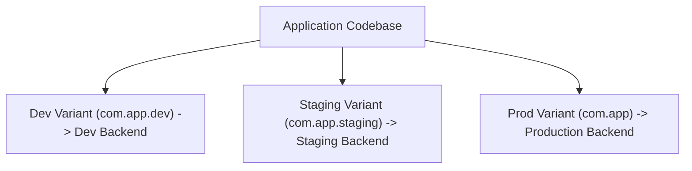

As applications mature, teams need to install multiple versions on the same test device simultaneously: a **Development** build pointing to localhost, a **Staging** build pointing to staging servers, and a **Production** build for store distribution.

In mobile engineering, this is accomplished via **Product Flavors** in Android and **Schemes / Build Configurations** in iOS.



---

## 1. Native Mapping: Android Flavors vs iOS Schemes

| Concept | Android Gradle | iOS Xcode | Flutter | React Native |
| :--- | :--- | :--- | :--- | :--- |
| **Environment Variant** | `productFlavors` (`dev`, `prod`) | `Scheme` + `Build Configuration` | `--flavor dev` | `ENVFILE=.env.dev` + Scheme |
| **Package / Bundle ID** | `applicationIdSuffix = ".dev"` | `PRODUCT_BUNDLE_IDENTIFIER` setting | Gradle flavor / Xcode target | Config suffix |
| **App Name** | `resValue "string", "app_name", "App Dev"` | `INFOPLIST_KEY_CFBundleDisplayName` | Flavor manifest / plist | Scheme plist |

---

## 2. Dynamic Flavor Handling in Fastlane

Instead of creating separate lanes like `lane :build_dev`, `lane :build_staging`, and `lane :build_prod`, pass the variant dynamically as a lane parameter:

### Android:
```ruby
platform :android do
  desc "Build AAB for a specific environment flavor (dev, staging, prod)"
  lane :build_flavor do |options|
    flavor = options[:flavor] || "prod"
    build_type = options[:type] || "Release"

    UI.header("Compiling Android [#{flavor.capitalize}#{build_type.capitalize}]")

    gradle(
      task: "bundle",
      flavor: flavor.capitalize,
      build_type: build_type.capitalize
    )
  end
end
```

Run from terminal:
```bash
bundle exec fastlane android build_flavor flavor:staging
bundle exec fastlane android build_flavor flavor:prod
```

### iOS:
```ruby
platform :ios do
  desc "Build IPA for a specific Scheme"
  lane :build_scheme do |options|
    scheme = options[:scheme] || "App-Production"
    export = options[:export] || "app-store"

    UI.header("Compiling iOS Scheme [#{scheme}]")

    # Match type: 'adhoc' for internal testing schemes, 'appstore' for production
    match_type = export == "app-store" ? "appstore" : "adhoc"
    match(type: match_type, readonly: is_ci)

    build_app(
      scheme: scheme,
      export_method: export
    )
  end
end
```

---

## 3. Dedicated Store Metadata Per Flavor

When deploying multiple variants or multi-tenant apps, isolate store metadata into separate directories named after the package name or bundle ID:

```ruby
lane :deploy_variant do |options|
  flavor = options[:flavor] || "prod"
  package_name = flavor == "prod" ? "com.example.app" : "com.example.app.#{flavor}"
  meta_dir = "fastlane/metadata/#{package_name}"

  upload_to_play_store(
    package_name: package_name,
    metadata_path: meta_dir,
    track: options[:track] || "internal"
  )
end
```
