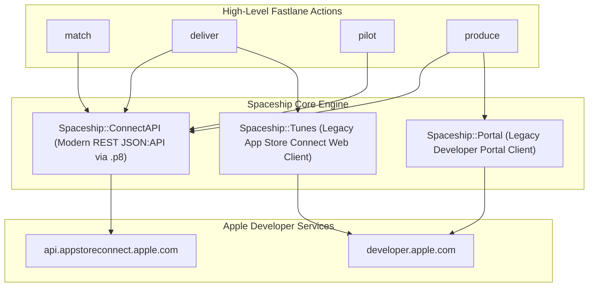

`Spaceship` is Fastlane's standalone Ruby HTTP client library for Apple services. Every standard action that communicates with Apple—including `cert`, `sigh`, `match`, `deliver`, `pilot`, and `produce`—is built entirely on top of Spaceship.

When Fastlane's high-level actions do not expose a specific Apple API capability (e.g. dynamic capability management, phased release throttling, or automated device registration), you can call Spaceship directly in your `Fastfile`.



---

## 1. Spaceship Architecture: ConnectAPI vs Legacy Subsystems

Spaceship historically consisted of web-scraping clients (`Portal` and `Tunes`) that mimicked browser sessions. Today, modern mobile CI/CD pipelines rely almost exclusively on `Spaceship::ConnectAPI`:

| Subsystem | Underlying Protocol | Authentication Mechanism | Supported Features |
|:---|:---|:---|:---|
| **`Spaceship::ConnectAPI`** *(Recommended)* | Official Apple REST API (JSON:API v1) | App Store Connect API Key (`.p8`) via JWT | Apps, Builds, TestFlight, Capabilities, Devices, Profiles, Phased Releases |
| **`Spaceship::Portal`** | Proprietary developer.apple.com web endpoints | Apple ID + Password + 2FA (`FASTLANE_SESSION`) | Legacy certificate & merchant ID operations |
| **`Spaceship::Tunes`** | Proprietary appstoreconnect.apple.com web endpoints | Apple ID + Password + 2FA (`FASTLANE_SESSION`) | Legacy Game Center leaderboards, In-App Purchase pricing tiers |

> [!TIP]
> Always target `Spaceship::ConnectAPI` for modern CI/CD automation. It is faster, immune to SMS/2FA prompts, and officially supported by Apple's engineering team.

---

## 2. Authenticating with `Spaceship::ConnectAPI`

To communicate with App Store Connect programmatically, initialize `Spaceship::ConnectAPI.token` using an API Key generated from **Users and Access** &rarr; **Integrations**:

```ruby
# Initialize token via filepath
Spaceship::ConnectAPI.token = Spaceship::ConnectAPI::Token.create(
  key_id: ENV["APP_STORE_CONNECT_API_KEY_KEY_ID"],
  issuer_id: ENV["APP_STORE_CONNECT_API_KEY_ISSUER_ID"],
  filepath: File.expand_path("AuthKey.p8", __dir__)
)

# Alternatively, initialize from an environment variable (Base64 or Raw PEM)
Spaceship::ConnectAPI.token = Spaceship::ConnectAPI::Token.create(
  key_id: ENV["APP_STORE_CONNECT_API_KEY_KEY_ID"],
  issuer_id: ENV["APP_STORE_CONNECT_API_KEY_ISSUER_ID"],
  key: ENV["APP_STORE_CONNECT_API_KEY_KEY"] # Raw string or decoded Base64
)
```

The `Token` object generates a signed JSON Web Token (JWT) with an expiration timestamp of 20 minutes and handles in-memory token refresh automatically.

---

## 3. Core Resource Hierarchy

Spaceship models map 1-to-1 with Apple's JSON:API resources:

### A. Applications (`Spaceship::ConnectAPI::App`)
```ruby
# Find app by bundle identifier
app = Spaceship::ConnectAPI::App.find("com.example.app")

UI.message("App Name: #{app.name}")
UI.message("Apple ID: #{app.id}")
UI.message("Bundle ID: #{app.bundle_id}")
```

### B. Bundle Identifiers & Capabilities
Bundle IDs and entitlements are managed via `Spaceship::ConnectAPI::BundleId` and `Spaceship::ConnectAPI::BundleIdCapability`:

```ruby
bundle = Spaceship::ConnectAPI::BundleId.find("com.example.app")
capabilities = bundle.get_capabilities

capabilities.each do |cap|
  UI.message("Enabled: #{cap.capability_type}")
end
```

> [!NOTE]
> For a complete step-by-step automation guide covering Push Notifications, Sign in with Apple, Associated Domains, and App Groups, see our dedicated recipe: [Programmatic Capabilities (Spaceship)](/fastlane-handbook/recipes/spaceship-bundle-id-capabilities/).

### C. TestFlight Beta Groups & Testers
```ruby
# 1. Fetch beta group
group = Spaceship::ConnectAPI::BetaGroup.all(filter: { name: "External Beta" }).first

# 2. Add tester
tester = Spaceship::ConnectAPI::BetaTester.create(
  email: "qa-lead@example.com",
  first_name: "Lead",
  last_name: "Tester"
)

group.add_beta_testers(beta_testers: [tester])
UI.success("Added #{tester.email} to #{group.name}")
```

### D. Automated Device Registration (UDID)
Register new test hardware dynamically without manual entry:

```ruby
device = Spaceship::ConnectAPI::Device.create(
  name: "Eng iPhone 15 Pro",
  platform: "IOS",
  udid: "00008101-001234567890ABCD"
)
UI.success("Registered device #{device.name} (ID: #{device.id})")
```

### E. Controlling Phased Releases
Monitor and adjust staged rollouts directly from your deploy pipeline:

```ruby
app = Spaceship::ConnectAPI::App.find("com.example.app")
live_version = app.get_live_app_store_version

if live_version && live_version.app_store_version_phased_release
  phased_release = live_version.app_store_version_phased_release
  UI.message("Phased Release State: #{phased_release.phased_release_state}")
  UI.message("Current Day: #{phased_release.current_day_number}")

  # Pause or Complete phased release
  # phased_release.pause
  # phased_release.complete
end
```

---

## 4. Interactive Terminal REPL (`bundle exec spaceship`)

Spaceship ships with a built-in interactive IRB shell. This allows you to explore live Apple data, test API calls, and inspect object attributes directly from your terminal:

```bash
bundle exec spaceship
```

Once launched, authenticate interactively:

```ruby
# Inside spaceship IRB console:
Spaceship::ConnectAPI.token = Spaceship::ConnectAPI::Token.create(
  key_id: "D383X7YKP4",
  issuer_id: "69a6de70-xxxx-xxxx-xxxx-xxxxxxxxxxxx",
  filepath: "./AuthKey_D383X7YKP4.p8"
)

# Inspect apps
apps = Spaceship::ConnectAPI::App.all
puts apps.map(&:name)

# Query latest build for an app
app = apps.first
latest_build = app.get_builds(limit: 1).first
puts "Build #{latest_build.version} uploaded at #{latest_build.uploaded_date}"
```

---

## 5. Defensive Programming & Error Handling

When interacting with Apple services, unexpected HTTP status codes (such as rate limits or invalid arguments) raise `Spaceship::UnexpectedResponse`. Always wrap sensitive network operations in defensive rescue blocks:

```ruby
begin
  bundle = Spaceship::ConnectAPI::BundleId.find("com.example.app")
  bundle.create_capability(Spaceship::ConnectAPI::BundleIdCapability::Type::PUSH_NOTIFICATIONS)
rescue Spaceship::UnexpectedResponse => e
  # Inspect Apple JSON:API error messages
  error_details = e.error_messages.join(", ")
  UI.error("Apple API Error: #{error_details}")
  UI.error("Raw response: #{e.response}")
  raise e
rescue StandardError => e
  UI.error("Unexpected error occurred: #{e.message}")
  raise e
end
```

### Apple API Rate Limiting (`HTTP 429 Too Many Requests`)
Apple enforces burst and rolling rate limits on App Store Connect API endpoints. For bulk operations (such as registering hundreds of devices or adding large groups of beta testers), insert exponential backoff or pacing:

```ruby
testers.each_slice(50) do |batch|
  # Process batch
  sleep(1.5) # Prevent burst limit throttling
end
```
