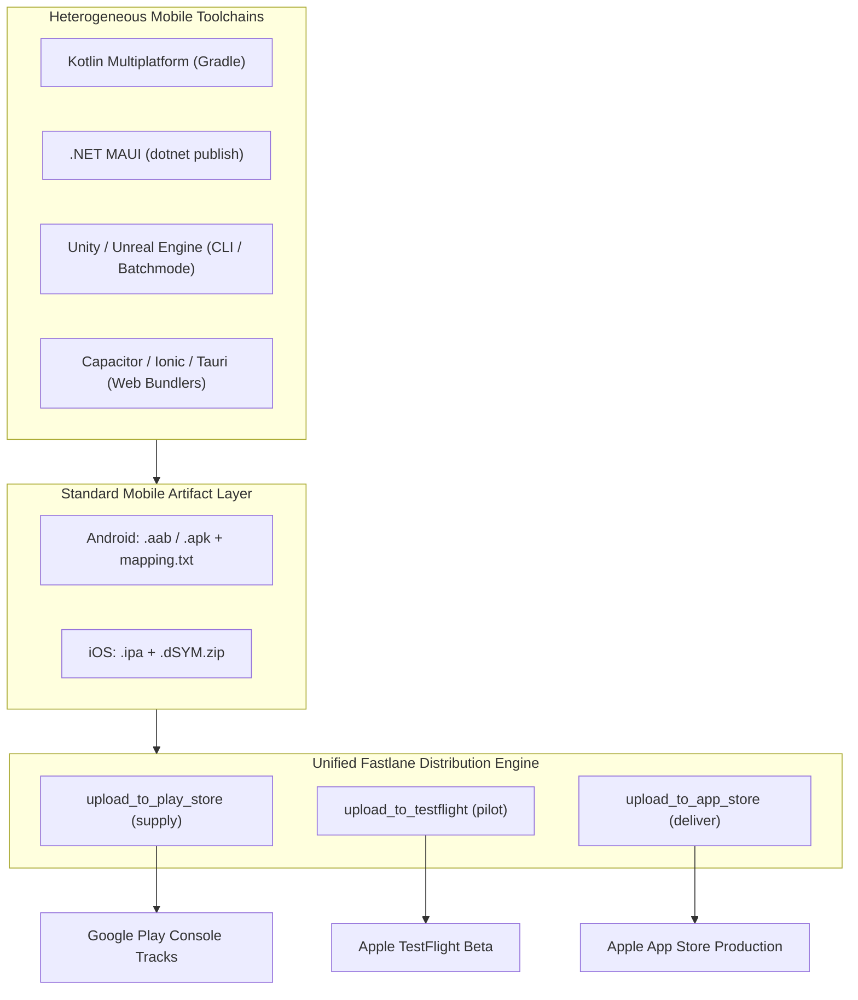

Mobile application engineering extends far beyond standard framework boundaries. Whether you are shipping high-performance games with **Unity** or **Unreal**, enterprise business apps with **.NET MAUI**, cross-platform UI with **Kotlin Multiplatform (KMP / Compose Multiplatform)**, or web hybrids with **Capacitor**, **Tauri Mobile**, or **Ionic**, Fastlane serves as the universal distribution engine.

The core principle is **Artifact-First Automation**: Fastlane's store engines (`supply`, `deliver`, `pilot`) do not inspect your source code language. They operate strictly on compiled binary artifacts, debug symbols, and authenticated API credentials.



---

## 1. Directory Structure for Any Tech Stack

Regardless of your repository layout, place a root `fastlane/` directory alongside your framework's configuration file:

```
my_mobile_project/
├── fastlane/
│   ├── Appfile                 # Global credentials & package identifiers
│   └── Fastfile                # Multi-platform deployment pipelines
├── build_output/               # Target directory where compilers emit binaries
│   ├── app-release.aab
│   ├── mapping.txt
│   ├── App.ipa
│   └── App.app.dSYM.zip
├── Gemfile                     # Pins fastlane gem
└── Gemfile.lock
```

In your `fastlane/Appfile`, define standard identifiers:

```ruby
# fastlane/Appfile
app_identifier("com.company.app")
apple_id("devops@company.com")
itc_team_id("118742918")
team_id("ABCDE12345")
json_key_file("fastlane/play-store-credentials.json")
```

---

## 2. Universal Artifact Distribution Lane

Here is a production-grade, framework-agnostic `Fastfile` that takes pre-built binaries and handles code signing verification, changelog publishing, symbol upload, and store releases:

```ruby
# fastlane/Fastfile
default_platform(:android)

platform :android do
  desc "Publish any Android AAB or APK to Google Play"
  lane :distribute do |options|
    aab_path = options[:aab] || ENV["ANDROID_AAB_PATH"] || "build_output/app-release.aab"
    mapping_path = options[:mapping] || "build_output/mapping.txt"
    target_track = options[:track] || "internal"

    UI.user_error!("Missing AAB binary at #{aab_path}") unless File.exist?(aab_path)

    upload_to_play_store(
      package_name: CredentialsManager::AppfileConfig.try_fetch_value(:app_identifier),
      track: target_track,
      aab: aab_path,
      mapping: File.exist?(mapping_path) ? mapping_path : nil,
      skip_upload_metadata: true,
      skip_upload_images: true,
      skip_upload_screenshots: true,
      release_status: "completed"
    )

    UI.success("Successfully uploaded #{aab_path} to Google Play [#{target_track}]")
  end
end

platform :ios do
  desc "Upload any pre-built IPA to Apple TestFlight"
  lane :distribute_testflight do |options|
    ipa_path = options[:ipa] || ENV["IOS_IPA_PATH"] || "build_output/App.ipa"
    dsym_path = options[:dsym] || "build_output/App.app.dSYM.zip"

    UI.user_error!("Missing IPA binary at #{ipa_path}") unless File.exist?(ipa_path)

    # Authenticate via App Store Connect API Key (.p8)
    api_key = app_store_connect_api_key(
      key_id: ENV["APP_STORE_CONNECT_KEY_ID"],
      issuer_id: ENV["APP_STORE_CONNECT_ISSUER_ID"],
      key_filepath: ENV["APP_STORE_CONNECT_KEY_PATH"],
      in_house: false
    )

    upload_to_testflight(
      api_key: api_key,
      ipa: ipa_path,
      skip_waiting_for_build_processing: true,
      distribute_external: false
    )

    UI.success("Successfully uploaded #{ipa_path} to TestFlight")
  end
end
```

---

## 3. Framework-Specific Compilations Hand-off

### A. Kotlin Multiplatform (KMP / Compose Multiplatform)
KMP projects use Gradle to produce both Android AABs and iOS XCFrameworks or CocoaPods archives:

```ruby
lane :build_and_release_kmp do
  # 1. Compile Android AAB via Gradle wrapper
  gradle(
    task: ":composeApp:bundleRelease",
    project_dir: "./"
  )

  # 2. Distribute generated AAB
  upload_to_play_store(
    track: "internal",
    aab: "composeApp/build/outputs/bundle/release/composeApp-release.aab"
  )
end
```

### B. .NET MAUI / C#
.NET MAUI projects use the `dotnet` CLI. Invoke the compiler via Fastlane's `sh` helper:

```ruby
lane :build_and_release_maui do
  # 1. Build and package signed Android AAB
  sh("dotnet publish -f net8.0-android -c Release /p:AndroidPackageFormat=aab")

  # 2. Upload output AAB
  upload_to_play_store(
    track: "internal",
    aab: Dir["bin/Release/net8.0-android/*-Signed.aab"].first
  )
end
```

### C. Unity / Game Engines
Unity games are compiled using headless command-line mode (`-batchmode`):

```ruby
lane :build_and_release_unity do
  unity_bin = "/Applications/Unity/Hub/Editor/2022.3.10f1/Unity.app/Contents/MacOS/Unity"

  # 1. Run headless build method inside your C# Editor script
  sh("#{unity_bin} -quit -batchmode -projectPath . -executeMethod BuildPipeline.BuildAndroidAAB -logFile unity_build.log")

  # 2. Upload resulting AAB & expansion files (OBB/Asset Packs)
  upload_to_play_store(
    track: "internal",
    aab: "builds/Android/game.aab"
  )
end
```

### D. Capacitor / Tauri Mobile / Web Hybrids
Web hybrid stacks output standard Xcode workspaces (`ios/App/`) and Gradle projects (`android/`):

```ruby
lane :build_and_release_hybrid do
  # 1. Sync web bundle into native platforms
  sh("npx cap sync")

  # 2. Build Android bundle
  gradle(
    task: "bundleRelease",
    project_dir: "./android"
  )

  # 3. Build iOS IPA via gym
  build_ios_app(
    workspace: "./ios/App/App.xcworkspace",
    scheme: "App",
    export_method: "app-store"
  )
end
```

---

## 4. Key Takeaways

1. **Decouple Compilation from Distribution**: Let your framework's native compiler do what it does best (compiling Dart, C#, C++, Rust, or JavaScript).
2. **Standardize on Output Artifacts**: Have your build scripts drop `.aab`, `.apk`, `.ipa`, and `.dSYM` files into a predictable directory (`build_output/`).
3. **Centralize Credentials in Fastlane**: Use Fastlane for all Google Play Service Accounts, App Store Connect API keys, and track management so you never duplicate publishing logic across disparate framework toolchains.
