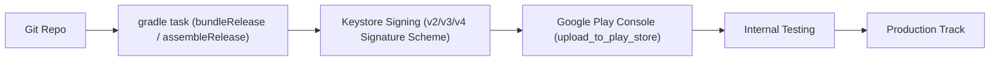

Native Android automation revolves around invoking Gradle tasks, signing APK or AAB binaries, and deploying to Google Play via `supply`.



---

## Directory Setup

In a native Android project, initialize Fastlane inside the `android/` directory:

```bash
cd android
bundle exec fastlane init
```

Recommended structure:
```
my-android-app/
├── app/
│   ├── build.gradle.kts
│   └── src/
├── fastlane/
│   ├── Appfile         # package_name & JSON key path
│   ├── Fastfile        # Android lanes
│   └── metadata/       # Google Play store metadata & changelogs
├── Gemfile
└── Gemfile.lock
```

---

## Configuring `Appfile`

The `Appfile` stores default metadata so you don't repeat them across lanes:

```ruby
# fastlane/Appfile
json_key_file("fastlane/play_store_key.json") # Path to Google Play service account JSON
package_name("com.example.androidapp")
```

---

## 1. Single-App Pipeline: Build & Deploy

For a standard Android application without flavors:

```ruby
# fastlane/Fastfile
default_platform(:android)

platform :android do
  desc "Compile release Android App Bundle (AAB)"
  lane :build do
    gradle(
      task: "bundle",
      build_type: "Release"
    )
  end

  desc "Build and deploy to Google Play Internal Testing"
  lane :beta do
    build

    upload_to_play_store(
      track: "internal",
      release_status: "completed",
      skip_upload_metadata: true,
      skip_upload_images: true,
      skip_upload_screenshots: true
    )
  end

  desc "Promote internal build to Production"
  lane :release do
    upload_to_play_store(
      track: "internal",
      track_promote_to: "production",
      track_promote_release_status: "completed",
      skip_upload_aab: true,
      skip_upload_apk: true
    )
  end
end
```

---

## 2. Managing Build Variants & Product Flavors

If your `build.gradle.kts` defines product flavors (e.g. `dev`, `staging`, `prod`):

```kotlin
// app/build.gradle.kts
android {
    flavorDimensions += "environment"
    productFlavors {
        create("dev") {
            dimension = "environment"
            applicationIdSuffix = ".dev"
        }
        create("prod") {
            dimension = "environment"
        }
    }
}
```

In Fastlane, pass the flavor directly into the `gradle` action:

```ruby
lane :build_flavor do |options|
  flavor = options[:flavor] || "prod"
  
  gradle(
    task: "bundle",
    flavor: flavor.capitalize, # e.g. "Prod" or "Dev"
    build_type: "Release"      # Produces bundleProdRelease
  )
end
```

---

## Essential Native Android Actions

| Action | Purpose | Primary Options |
| :--- | :--- | :--- |
| [`gradle`](/fastlane-handbook/actions/gradle/) | Executes any Gradle task (`bundleRelease`, `assembleDebug`, `test`) | `task`, `flavor`, `build_type`, `properties` |
| [`upload_to_play_store`](/fastlane-handbook/actions/upload_to_play_store/) | Uploads binaries, changelogs, and metadata via *supply* | `package_name`, `aab`, `track`, `rollout` |
| [`validate_play_store_json_key`](/fastlane-handbook/actions/validate_play_store_json_key/) | Verifies Google Play service account credentials | `json_key` |
| [`screengrab`](/fastlane-handbook/actions/screengrab/) | Automates localized Android screenshots using Espresso | `locales`, `app_apk_path` |
