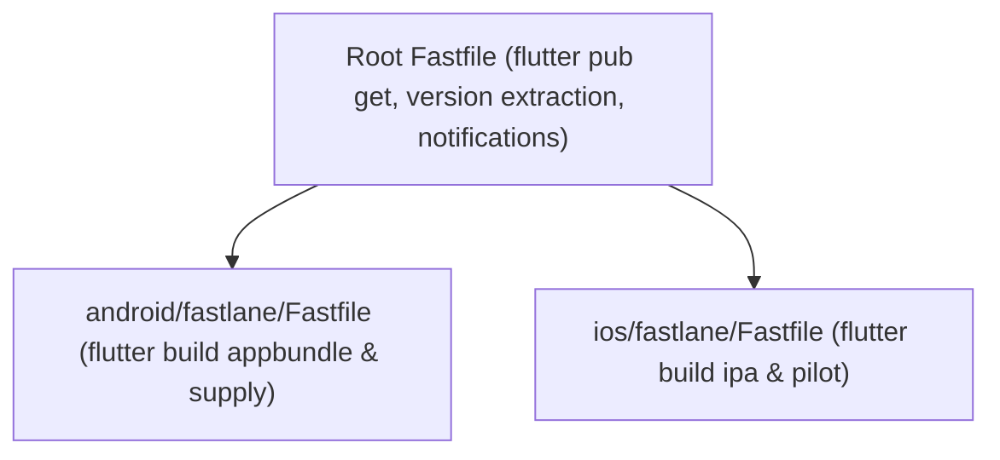

Flutter projects compile down to native artifacts (AAB/APK on Android, IPA on iOS). The recommended industry architecture is a **dual-tier Fastlane setup**: native platform Fastfiles inside `android/fastlane/` and `ios/fastlane/`, orchestrated by a root Fastfile.



---

## Directory Architecture

```
my_flutter_app/
├── pubspec.yaml            # Single source of truth for version + build
├── android/
│   ├── app/build.gradle.kts
│   └── fastlane/
│       ├── Appfile
│       └── Fastfile        # Android native lanes
├── ios/
│   ├── Runner.xcworkspace
│   └── fastlane/
│       ├── Appfile
│       ├── Matchfile
│       └── Fastfile        # iOS native lanes
├── fastlane/
│   └── Fastfile            # Unified root orchestrator
├── Gemfile
└── Gemfile.lock
```

---

## 1. Extracting Version from `pubspec.yaml`

Instead of hardcoding build numbers, read the version directly from `pubspec.yaml`:

```ruby
# fastlane/helpers/flutter_version_helper.rb
require 'yaml'

module FlutterVersionHelper
  def self.load_version(repo_root)
    pubspec = YAML.load_file(File.join(repo_root, 'pubspec.yaml'))
    version_line = pubspec['version'] # e.g. "1.2.0+42"
    version_name, build_number = version_line.split('+')
    
    {
      version_name: version_name,
      build_number: build_number.to_i
    }
  end
end
```

---

## 2. Compiling Flutter Binaries via Fastlane `sh`

Use Fastlane's `sh` action to trigger the Flutter toolchain before running upload actions:

### Android Lane:
```ruby
# android/fastlane/Fastfile
platform :android do
  lane :build_and_deploy do |options|
    repo_root = File.expand_path('../..', __dir__)
    
    # 1. Compile AAB via Flutter CLI
    sh("flutter", "build", "appbundle", "--release", chdir: repo_root)

    # 2. Locate generated AAB
    aab_path = File.join(repo_root, "build/app/outputs/bundle/release/app-release.aab")

    # 3. Upload to Google Play
    upload_to_play_store(
      aab: aab_path,
      track: options[:track] || "internal"
    )
  end
end
```

### iOS Lane:
```ruby
# ios/fastlane/Fastfile
platform :ios do
  lane :build_and_deploy do |options|
    repo_root = File.expand_path('../..', __dir__)

    # 1. Sync certificates
    match(type: "appstore", readonly: is_ci)

    # 2. Build IPA via Flutter CLI
    sh("flutter", "build", "ipa", "--release", "--export-options-plist=ios/ExportOptions.plist", chdir: repo_root)

    # 3. Locate generated IPA
    ipa_path = Dir.glob(File.join(repo_root, "build/ios/ipa/*.ipa")).first

    # 4. Upload to TestFlight
    upload_to_testflight(
      ipa: ipa_path,
      skip_waiting_for_build_processing: true
    )
  end
end
```

---

## 3. Passing Flutter Flavors (`--flavor`)

When managing multiple environments (e.g. `dev`, `staging`, `prod`):

```ruby
lane :build_flavor do |options|
  flavor = options[:flavor] || "staging"
  target = "lib/main_#{flavor}.dart"

  sh("flutter", "build", "appbundle",
     "--flavor", flavor,
     "--target", target,
     "--release")
end
```
