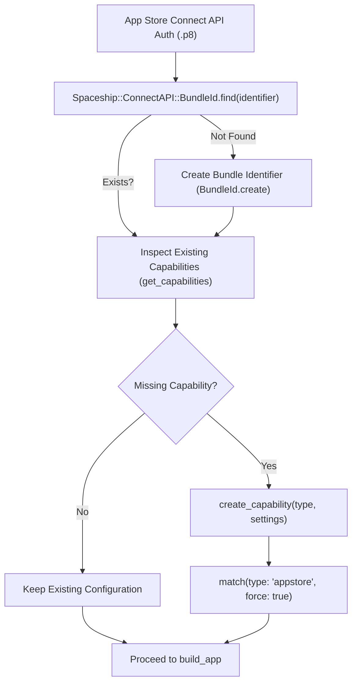

Standard Fastlane actions such as `produce` or `sigh` can register an App Identifier, but they offer limited control when managing advanced Apple capabilities—especially in white-label pipelines, dynamic multi-tenant flavors, or multi-target apps (e.g. Notification Service Extensions, Watch Apps, and Widget Extensions).

By tapping into `Spaceship::ConnectAPI::BundleId` and `Spaceship::ConnectAPI::BundleIdCapability`, you can query, enable, and configure Apple capabilities directly within your `Fastfile` using your App Store Connect API Key (`.p8`).

---

## Architecture Pipeline



> [!IMPORTANT]
> Modifying bundle capabilities in App Store Connect immediately invalidates existing provisioning profiles. You **must** regenerate your provisioning profiles (e.g. via `match(..., force: true)`) before building the archive in Xcode.

---

## 1. Authentication Prerequisite

All modern Spaceship capability operations require initializing `Spaceship::ConnectAPI.token` using your App Store Connect API key (`.p8`):

```ruby
def setup_spaceship_token
  Spaceship::ConnectAPI.token = Spaceship::ConnectAPI::Token.create(
    key_id: ENV["APP_STORE_CONNECT_API_KEY_KEY_ID"],
    issuer_id: ENV["APP_STORE_CONNECT_API_KEY_ISSUER_ID"],
    filepath: File.expand_path(ENV["APP_STORE_CONNECT_API_KEY_PATH"], __dir__)
    # Or in-memory base64: key: Base64.decode64(ENV["APP_STORE_CONNECT_API_KEY_KEY"])
  )
end
```

---

## 2. Idempotent Bundle Identifier Helper

Before adding capabilities, ensure the App Identifier exists in App Store Connect. If it does not exist, create it:

```ruby
def ensure_bundle_id(identifier:, name:, platform: "UNIVERSAL")
  setup_spaceship_token

  bundle_id = Spaceship::ConnectAPI::BundleId.find(identifier)
  if bundle_id
    UI.message("Found existing App Identifier: #{identifier} (ID: #{bundle_id.id})")
    return bundle_id
  end

  UI.message("Registering new App Identifier: #{identifier} (#{name})...")
  Spaceship::ConnectAPI::BundleId.create(
    identifier: identifier,
    name: name,
    platform: platform # 'IOS', 'MAC_OS', or 'UNIVERSAL'
  )
end
```

---

## 3. Querying Existing Capabilities

To inspect which capabilities are already enabled on a bundle identifier:

```ruby
lane :check_app_capabilities do |options|
  bundle_id_str = options[:bundle_id] || "com.example.myapp"
  bundle_id = ensure_bundle_id(identifier: bundle_id_str, name: "MyApp")

  capabilities = bundle_id.get_capabilities
  UI.header("Enabled Capabilities for #{bundle_id_str} (#{capabilities.size} total)")

  capabilities.each do |cap|
    UI.message(" • #{cap.capability_type} (ID: #{cap.id})")
  end
end
```

---

## 4. Enabling Specific Capabilities

### A. Sign in with Apple (`APPLE_ID_AUTH`)

Sign in with Apple requires defining the app consent setting:

```ruby
def enable_sign_in_with_apple(bundle_id)
  existing = bundle_id.get_capabilities.find { |c| c.is_type?(Spaceship::ConnectAPI::BundleIdCapability::Type::APPLE_ID_AUTH) }
  return UI.message("Sign in with Apple is already enabled.") if existing

  UI.message("Enabling Sign in with Apple...")
  bundle_id.create_capability(
    Spaceship::ConnectAPI::BundleIdCapability::Type::APPLE_ID_AUTH,
    settings: [
      {
        key: Spaceship::ConnectAPI::BundleIdCapability::Settings::APPLE_ID_AUTH_APP_CONSENT,
        options: [
          { key: Spaceship::ConnectAPI::BundleIdCapability::Options::PRIMARY_APP_CONSENT }
        ]
      }
    ]
  )
  UI.success("Sign in with Apple successfully enabled.")
end
```

### B. Push Notifications (`PUSH_NOTIFICATIONS`)

Push Notifications do not require special settings parameters at the capability registration level:

```ruby
def enable_push_notifications(bundle_id)
  existing = bundle_id.get_capabilities.find { |c| c.is_type?(Spaceship::ConnectAPI::BundleIdCapability::Type::PUSH_NOTIFICATIONS) }
  return UI.message("Push Notifications already enabled.") if existing

  UI.message("Enabling Push Notifications...")
  bundle_id.create_capability(
    Spaceship::ConnectAPI::BundleIdCapability::Type::PUSH_NOTIFICATIONS
  )
  UI.success("Push Notifications capability successfully enabled.")
end
```

### C. Associated Domains (Universal Links)

Associated Domains (`ASSOCIATED_DOMAINS`) enables Universal Links and Web Credentials autofill:

```ruby
def enable_associated_domains(bundle_id)
  existing = bundle_id.get_capabilities.find { |c| c.is_type?(Spaceship::ConnectAPI::BundleIdCapability::Type::ASSOCIATED_DOMAINS) }
  return UI.message("Associated Domains already enabled.") if existing

  UI.message("Enabling Associated Domains...")
  bundle_id.create_capability(
    Spaceship::ConnectAPI::BundleIdCapability::Type::ASSOCIATED_DOMAINS
  )
  UI.success("Associated Domains successfully enabled.")
end
```

### D. App Groups (`APP_GROUPS`)

App Groups allows sharing data containers between the main application and its App Extensions (Widgets, Share Sheet, Notification Content):

```ruby
def enable_app_groups(bundle_id)
  existing = bundle_id.get_capabilities.find { |c| c.is_type?(Spaceship::ConnectAPI::BundleIdCapability::Type::APP_GROUPS) }
  return UI.message("App Groups capability already enabled.") if existing

  UI.message("Enabling App Groups...")
  bundle_id.create_capability(
    Spaceship::ConnectAPI::BundleIdCapability::Type::APP_GROUPS
  )
  UI.success("App Groups capability enabled.")
end
```

---

## 5. Deleting Deprecated Capabilities

If an entitlement is no longer needed or must be revoked:

```ruby
def revoke_capability(bundle_id, capability_type)
  cap = bundle_id.get_capabilities.find { |c| c.is_type?(capability_type) }
  if cap
    UI.message("Revoking capability #{capability_type} (ID: #{cap.id})...")
    cap.delete!
    UI.success("Revoked #{capability_type}.")
  else
    UI.message("Capability #{capability_type} not found on #{bundle_id.identifier}.")
  end
end
```

---

## 6. Complete End-to-End Automation Lane

Here is a production-grade lane that sets up an app identifier, ensures required capabilities are active, and regenerates provisioning profiles using `match`:

```ruby
# fastlane/Fastfile

default_platform(:ios)

platform :ios do
  desc "Provision Bundle Identifier and Entitlements Programmatically"
  lane :configure_capabilities do |options|
    app_id = options[:bundle_id] || "com.company.iosapp"
    app_name = options[:name] || "Production App"

    # 1. Initialize API Token
    setup_spaceship_token

    # 2. Ensure Bundle ID Exists
    bundle = ensure_bundle_id(identifier: app_id, name: app_name)

    # 3. Apply Required Capabilities
    capabilities_mutated = false

    caps = bundle.get_capabilities
    has_auth = caps.any? { |c| c.is_type?(Spaceship::ConnectAPI::BundleIdCapability::Type::APPLE_ID_AUTH) }
    has_push = caps.any? { |c| c.is_type?(Spaceship::ConnectAPI::BundleIdCapability::Type::PUSH_NOTIFICATIONS) }
    has_domains = caps.any? { |c| c.is_type?(Spaceship::ConnectAPI::BundleIdCapability::Type::ASSOCIATED_DOMAINS) }

    unless has_auth
      enable_sign_in_with_apple(bundle)
      capabilities_mutated = true
    end

    unless has_push
      enable_push_notifications(bundle)
      capabilities_mutated = true
    end

    unless has_domains
      enable_associated_domains(bundle)
      capabilities_mutated = true
    end

    # 4. Invalidate & Regenerate Provisioning Profiles if Capabilities Changed
    if capabilities_mutated
      UI.important("Capabilities changed on Apple Developer Portal. Regenerating profiles with match...")
      match(
        type: "appstore",
        app_identifier: app_id,
        force: true
      )
      UI.success("Provisioning profiles successfully regenerated with updated entitlements!")
    else
      UI.message("All capabilities are already synchronized. No profile regeneration needed.")
    end
  end
end
```

---

## 7. Capability Types Reference Dictionary

Below is the definitive reference table of constants available in `Spaceship::ConnectAPI::BundleIdCapability::Type` as exported by the Fastlane engine (automatically synchronized from upstream Fastlane releases):

{/* AUTO-GENERATED-SPACESHIP-CAPABILITIES-START */}
| Type Constant (`Spaceship::ConnectAPI::BundleIdCapability::Type::*`) | Apple Entitlement Description | Supported Settings |
|:---|:---|:---|
| `ACCESS_WIFI_INFORMATION` | Access Wi-Fi Information & Network Extension Wi-Fi info | None |
| `APPLE_ID_AUTH` | Sign in with Apple authentication | `APPLE_ID_AUTH_APP_CONSENT` (`PRIMARY_APP_CONSENT`) |
| `APPLE_PAY` | Apple Pay Merchant payment processing | Linked Merchant Identifiers |
| `APP_ATTEST` | DeviceCheck & App Attest fraud protection | None |
| `APP_GROUPS` | Shared data storage between App & App Extensions | Linked Group Identifiers |
| `ASSOCIATED_DOMAINS` | Universal Links, App Clips, & Shared Web Credentials | Configured via `.entitlements` |
| `AUTOFILL_CREDENTIAL_PROVIDER` | Password manager credential provider extensions | None |
| `CARPLAY_MESSAGING` | CarPlay messaging readout & Siri compose | Apple Special Approval Required |
| `CARPLAY_NAVIGATION` | CarPlay turn-by-turn navigation & maps | Apple Special Approval Required |
| `CARPLAY_PLAYABLE_CONTENT` | CarPlay audio streaming & playable content | Apple Special Approval Required |
| `CARPLAY_VOIP` | CarPlay telephony & VoIP call routing | Apple Special Approval Required |
| `CLASSKIT` | ClassKit student progress recording | None |
| `COREMEDIA_HLS_LOW_LATENCY` | Low-latency HLS video broadcasting | None |
| `CRITICAL_ALERTS` | Bypasses Do Not Disturb / Mute hardware switch | Apple Special Approval Required |
| `DATA_PROTECTION` | Complete / Protected filesystem encryption | `DATA_PROTECTION_PERMISSION_LEVEL` |
| `DECLARED_AGE_RANGE` | Declared Age Range verification (App Store Connect compliance) | None |
| `DRIVERKIT` | DriverKit user-space hardware driver execution | Apple Special Approval Required |
| `DRIVERKIT_ENDPOINT_SECURITY` | Endpoint Security client extension driver | Apple Special Approval Required |
| `DRIVERKIT_HID` | Human Interface Device (HID) driver | Apple Special Approval Required |
| `DRIVERKIT_HID_DEVICE` | HID USB/PCIe hardware device access | Apple Special Approval Required |
| `DRIVERKIT_HID_EVENT_SERVICE` | HID Event Service custom event dispatch | Apple Special Approval Required |
| `DRIVERKIT_NETWORKING` | Network interface Ethernet driver | Apple Special Approval Required |
| `DRIVERKIT_SERIAL` | Serial / USB-UART communications driver | Apple Special Approval Required |
| `EXTENDED_VIRTUAL_ADDRESSING` | Increased 64-bit virtual memory address space | None |
| `FAMILY_CONTROLS` | Screen Time API parental & usage controls | Apple Special Approval Required |
| `FILEPROVIDER_TESTINGMODE` | Cloud FileProvider framework testing mode | None |
| `FONT_INSTALLATION` | Dynamic system font provider extensions | None |
| `GAME_CENTER` | Apple Game Center achievements & leaderboards | `GAME_CENTER_SETTING` |
| `GROUP_ACTIVITIES` | SharePlay synchronized group experiences | None |
| `HEALTHKIT` | HealthKit health & clinical record access | None |
| `HEALTHKIT_RECALIBRATE_ESTIMATES` | HealthKit custom baseline recalibration | Apple Special Approval Required |
| `HLS_INTERSTITIAL_PREVIEW` | HLS video stream interstitial ad preview | None |
| `HOMEKIT` | HomeKit connected smart home accessories | None |
| `HOTSPOT_HELPER_MANAGED` | MDM-managed Hotspot Helper Wi-Fi configuration | Apple Special Approval Required |
| `HOT_SPOT` | Hotspot Helper Wi-Fi network configuration | None |
| `ICLOUD` | iCloud Key-Value Storage & CloudKit database | `ICLOUD_VERSION` |
| `INTER_APP_AUDIO` | Legacy Inter-App Audio routing | None |
| `IN_APP_PURCHASE` | StoreKit In-App Purchases & Subscriptions | None |
| `IPAD_CAMERA_MULTITASKING` | iPad Multitasking Camera access while in Split View | None |
| `MAPS` | Turn-by-turn routing app coverage document | None |
| `MARZIPAN` | Mac Catalyst cross-platform app porting | None |
| `MDM_MANAGED_ASSOCIATED_DOMAINS` | MDM-managed Associated Domains & Enterprise Universal Links | None |
| `MULTIPATH` | Multipath TCP (MPTCP) network failover | None |
| `MUSIC_KIT` | Apple Music catalog & personal subscriber library | None |
| `NETWORK_CUSTOM_PROTOCOL` | Custom network packet tunneling protocol | None |
| `NETWORK_EXTENSIONS` | Packet tunnels, DNS proxies, and content filters | None |
| `NFC_TAG_READING` | CoreNFC Tag Reading & Writing | None |
| `PERSONAL_VPN` | NEVPNManager personal VPN tunnels | None |
| `PUSH_NOTIFICATIONS` | Apple Push Notification service (APNs) | None (default) |
| `SFUNIVERSALLINK_API` | Safari Universal Link programmatic verification | None |
| `SHAZAM_KIT` | Audio fingerprinting & song recognition | None |
| `SIRIKIT` | Siri voice shortcuts & custom intents | None |
| `SYSTEM_EXTENSION_INSTALL` | macOS / DriverKit daemon install entitlement | None |
| `USERNOTIFICATIONS_COMMUNICATION` | Communication & VoIP call notifications | None |
| `USERNOTIFICATIONS_TIMESENSITIVE` | Time-sensitive break-through notifications | None |
| `USER_MANAGEMENT` | Multi-user Apple School Manager support | None |
| `VP9_DECODER` | Hardware-accelerated VP9 video decoding | None |
| `WALLET` | PassKit digital wallet passes & loyalty cards | Linked Pass Type Identifiers |
| `WIRELESS_ACCESSORY_CONFIGURATION` | MFi wireless accessory configuration (WAC) | None |
{/* AUTO-GENERATED-SPACESHIP-CAPABILITIES-END */}

---

## 8. Troubleshooting & Common Pitfalls

### `403 Forbidden: User is not authorized to create capability`
- **Cause**: The App Store Connect API Key (`.p8`) does not have sufficient role permissions.
- **Solution**: Capability mutation requires an API Key with `Admin` or `App Manager` permissions. A key with `Developer` or `Marketing` privileges will be rejected by Apple.

### `409 Conflict: Capability already exists`
- **Cause**: Attempting to call `create_capability` when that capability type is already present on the bundle ID.
- **Solution**: Always use defensive querying (`bundle_id.get_capabilities.any? { |c| c.is_type?(type) }`) before calling `create_capability`.

### Provisioning Profile Code Signing Mismatch in Xcode (`Provisioning profile doesn't include the [XYZ] entitlement`)
- **Cause**: The capability was enabled in Apple Developer Portal, but local provisioning profiles cached by Xcode or fastlane still have the old entitlement footprint.
- **Solution**: Run `bundle exec fastlane match appstore --force` (or `bundle exec fastlane sigh --force`) to force Apple to issue a new mobileprovision file reflecting the new capability.
