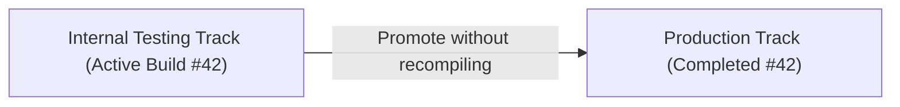

A major anti-pattern in mobile CI/CD is re-building the application binary when promoting from QA / internal testing to production. 

Recompiling introduces the risk of subtle environment discrepancies, timestamp mutations, and unverified compiler changes. The binary tested by QA should be the exact cryptographic artifact deployed to end users.

Fastlane's `upload_to_play_store` (powered by `supply`) supports zero-rebuild track promotion natively when configured properly.

---

## How Track Promotion Works

Instead of passing an `aab` or `apk` file path, you instruct `supply` to look up the currently active build on a source track and reassign it to a target track.



---

## Production Lane Implementation

```ruby
# android/fastlane/lanes/promote.rb
platform :android do
  desc "Promote an existing Google Play build from one track to another without recompiling"
  lane :promote_track do |options|
    package_name = options[:package_name] || UI.user_error!("Missing package_name")
    from_track   = options[:from_track] || "internal"
    to_track     = options[:to_track] || "production"
    status       = options[:status] || "completed" # completed, draft, or inProgress
    rollout      = options[:rollout] ? options[:rollout].to_f : nil

    UI.header("Promoting #{package_name} from [#{from_track}] to [#{to_track}]")

    supply_args = {
      package_name: package_name,
      track: from_track,
      track_promote_to: to_track,
      track_promote_release_status: status,
      skip_upload_apk: true,
      skip_upload_aab: true,
      skip_upload_metadata: true,
      skip_upload_changelogs: false, # Allow attaching production changelog
      skip_upload_images: true,
      skip_upload_screenshots: true
    }

    # Staged rollout support (e.g., rollout: 0.1 for 10% gradual rollout)
    if rollout && rollout < 1.0
      supply_args[:track_promote_release_status] = "inProgress"
      supply_args[:rollout] = rollout
      UI.important("Executing staged rollout at #{rollout * 100}%")
    end

    upload_to_play_store(supply_args)

    UI.success("Successfully promoted #{package_name} to #{to_track}!")
  end
end
```

---

## Terminal Usage

Promote the latest build tested in `internal` directly to `production`:
```bash
bundle exec fastlane android promote_track \
  package_name:com.example.app \
  from_track:internal \
  to_track:production
```

Or trigger a 20% staged rollout:
```bash
bundle exec fastlane android promote_track \
  package_name:com.example.app \
  from_track:internal \
  to_track:production \
  rollout:0.2
```

### Benefits:
- **Instant deployment**: No 15-minute Gradle build step in CI.
- **Audit integrity**: The SHA256 checksum tested in staging matches production byte-for-byte.
- **Rollback capability**: Staged rollouts can be halted immediately through the Play Console or Fastlane without redeploying code.
