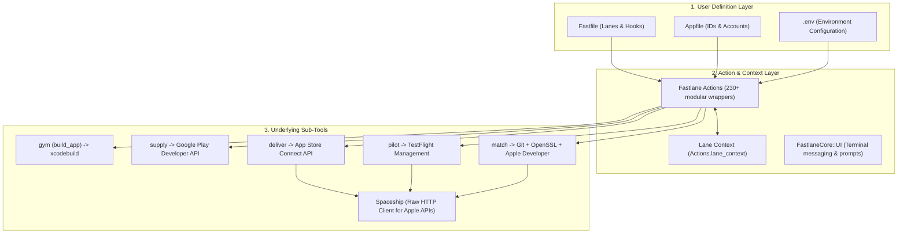

Understanding Fastlane requires looking past the simple `lane` DSL and understanding the three architectural layers that make up the system:

## The Three Layers

### 1. User Definition Layer (`Fastfile`, `Appfile`, `.env`)
- **`Fastfile`**: Defines your workflows ("lanes") and lifecycle hooks (`before_all`, `after_all`, `error`).
- **`Appfile`**: Sets default application identifiers (bundle ID, package name, Apple Developer Team ID, iTunes Connect account) so actions do not need them passed repeatedly.
- **`.env` files**: Fastlane automatically loads `.env`, `.env.default`, and `.env.<lane>` via the `dotenv` gem when present.

### 2. Action & Context Layer
When you call `build_app(...)` or `upload_to_play_store(...)`, you are calling a subclass of `Fastlane::Action`.
- Every action receives a typed dictionary of options (`FastlaneCore::ConfigItem`).
- Fastlane performs automatic validation: verifying that required options exist, resolving fallback environment variables, and verifying file paths.
- Actions communicate silently via **`Actions.lane_context`**. For example, when `build_app` runs, it places the path of the generated IPA into `Actions.lane_context[SharedValues::IPA_OUTPUT_PATH]`. Downstream actions like `upload_to_app_store` inspect this key automatically.

### 3. Underlying Sub-Tools (The Engines)
Fastlane's actions are largely orchestrators over specialized sub-tools:
- **`gym`**: Wraps `xcodebuild archive` and `xcodebuild -exportArchive`, parsing the output into colored terminal logs.
- **`supply`**: Direct client for Google Play Developer API (v3), managing APKs, AABs, tracks, release notes, and store listings.
- **`match`**: Generates and manages iOS certificates and provisioning profiles using a shared Git repository or cloud storage with OpenSSL encryption.
- **`spaceship`**: Fastlane's internal Ruby HTTP client that speaks directly to Apple's Developer Portal and App Store Connect APIs.
