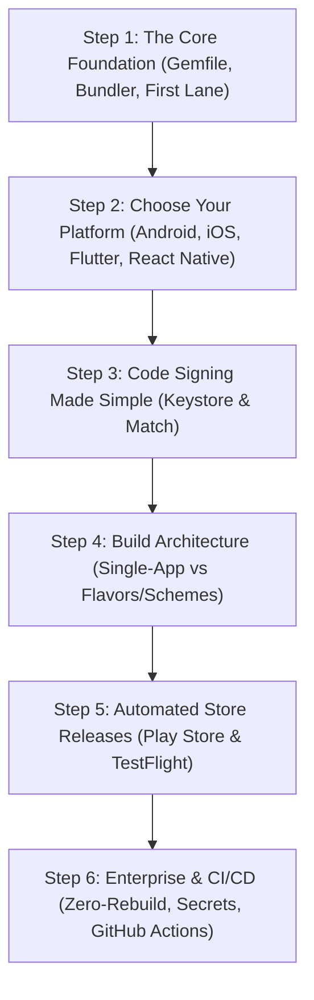

Mobile automation can feel overwhelming when confronted with hundreds of actions and configuration files. Follow this **6-step progressive roadmap** to master Fastlane without confusion.

---

## The 6 Progressive Milestones

### Milestone 1: The Core Foundation
- **Goal**: Understand the Fastlane mental model and avoid system Ruby traps.
- **Current Fastlane Baseline**: Fastlane `v2.241.2` strictly requires **Ruby >= 3.2.0** (Ruby `3.3.0+` is officially recommended).

:::caution[The macOS System Ruby Trap]
macOS still ships with an outdated system Ruby (v2.6) which is unsupported by modern Fastlane versions. Attempting to run `sudo gem install fastlane` will lead to permission errors or broken dependencies. **Always** install Ruby via a version manager like `rbenv`, `mise`, or install Fastlane via Homebrew (`brew install fastlane`).
:::

- **What to study**:
  1. [Fastlane Architecture & Mental Model](/fastlane-handbook/start/architecture/)
  2. [CLI & Bundler vs System Gem](/fastlane-handbook/rosetta-stone/cli-and-bundler/) (Locking versions with `Gemfile.lock`)
  3. [Fastlane Ruby Essentials](/fastlane-handbook/rosetta-stone/ruby-for-mobile-devs/) (Symbols, hashes, blocks)

---

### Milestone 2: Pick Your Platform Guide
- **Goal**: Implement Fastlane using conventions tailored to your mobile tech stack.
- **Choose your guide**:
  - [Native Android (Kotlin / Gradle)](/fastlane-handbook/platforms/android/)
  - [Native iOS (Swift / Xcode)](/fastlane-handbook/platforms/ios/)
  - [Flutter (Dart / Hybrid)](/fastlane-handbook/platforms/flutter/)
  - [React Native (TypeScript / Hermes)](/fastlane-handbook/platforms/react-native/)

---

### Milestone 3: Code Signing Without Tears
- **Goal**: Automate code signing so builds never fail due to expired certificates or missing keystores.
- **Key topics**:
  - Android: [Keystore Decryption & Pre-Flight Guards](/fastlane-handbook/recipes/signing-and-keystore-security/)
  - iOS: [App Store Connect API (.p8)](/fastlane-handbook/recipes/app-store-connect-api/) & [`match`](/fastlane-handbook/actions/match/)

---

### Milestone 4: Choose Your Build Architecture
- **Goal**: Structure your lanes according to your project's complexity.
- **Choose one**:
  - [Standard Single-App Pipeline](/fastlane-handbook/architecture/single-app-pipeline/) (If you have one app, one target, and one bundle ID)
  - [Flavors & Schemes Guide](/fastlane-handbook/architecture/flavors-and-schemes/) (If you manage Dev, Staging, and Production variants)

---

### Milestone 5: Automated Store Releases
- **Goal**: One-command distribution to beta testers and public stores.
- **Core actions**:
  - Android: [`upload_to_play_store`](/fastlane-handbook/actions/upload_to_play_store/)
  - iOS: [`upload_to_testflight`](/fastlane-handbook/actions/upload_to_testflight/) and [`upload_to_app_store`](/fastlane-handbook/actions/upload_to_app_store/)

---

### Milestone 6: Enterprise CI/CD & Advanced Pipelines
- **Goal**: Zero human touch between git commit and public release.
- **Advanced topics**:
  - [Zero-Rebuild Track Promotion](/fastlane-handbook/recipes/zero-rebuild-promotion/)
  - [Lane Context & Shared Values](/fastlane-handbook/internals/lane-context-and-shared-values/)
  - [Spaceship API Reference](/fastlane-handbook/internals/spaceship-deep-dive/)
  - [Custom Actions Authoring](/fastlane-handbook/internals/custom-actions/)
